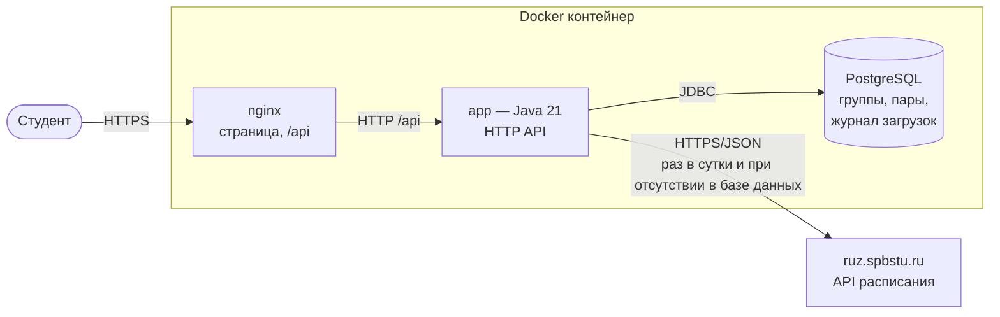
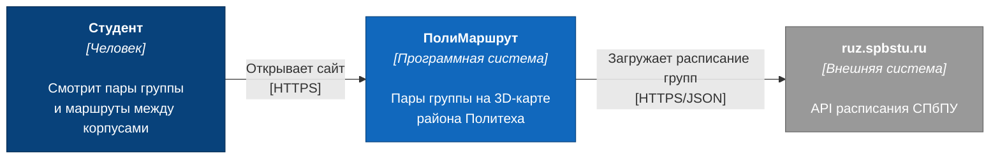
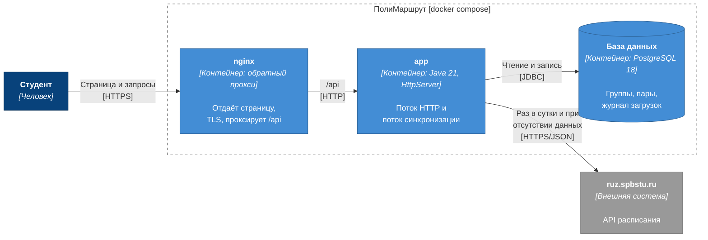
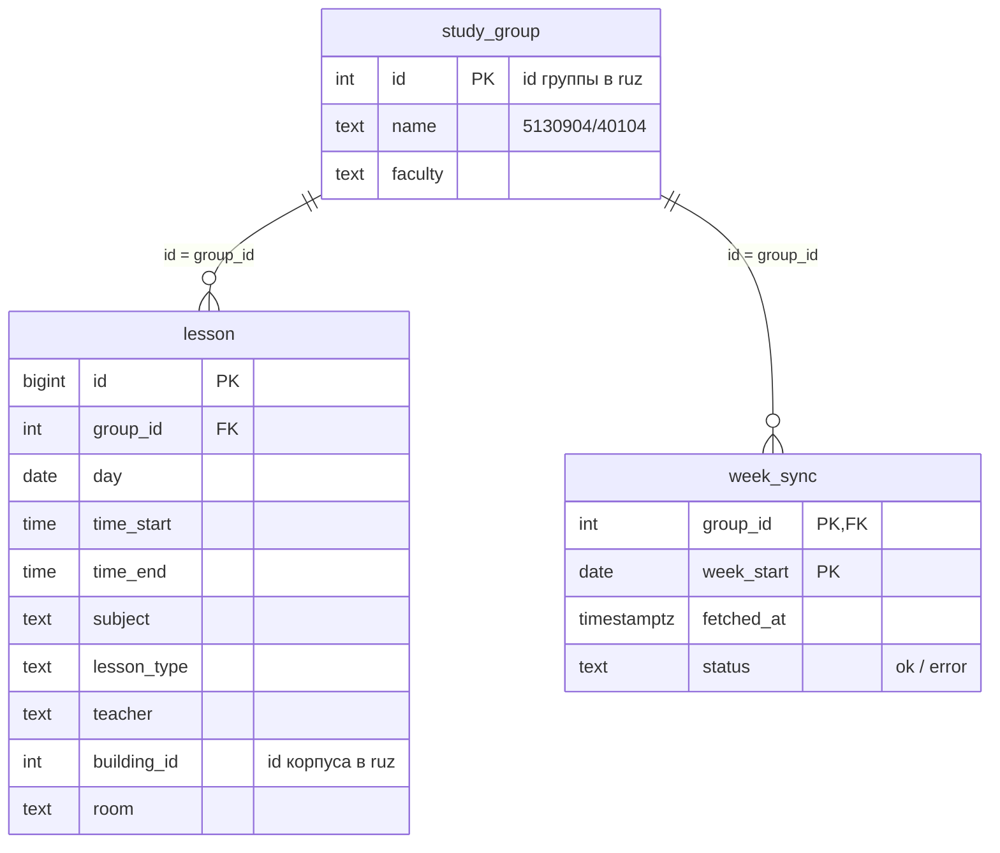
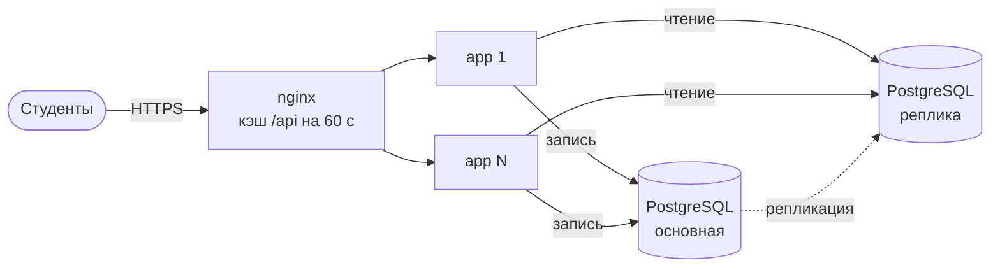

Курсовой проект по дисциплине «Конструирование программного обеспечения», СПбПУ, 2026.

# ПолиМаршрут
Веб-сервис расписания СПбПУ: показывает пары группы на день на 3D-карте района Политеха.

|Участники|
|-|
|Асафов Андрей Николаевич|
|Кабанов Илья Николаевич|
|Масловский Владислав Артёмович|
|Черкасов Никита Алексеевич|

Группа 5130904/40104

## Определение проблемы
Студентам первого курса тяжело запомнить все корпуса где находятся их пары, и дальше в течении обучения могут появляться пары в новых корпусах, о которых студенты прежде не знали, из-за большого колличества корпусов в нашем университете.

## Выработка требований
### Пользовательские истории
1. **Когда** я смотрю расписание на день, **я хочу** видеть на карте маршрут между корпусами соседних пар.
2. **Когда** я снова открываю сайт, **я хочу**, чтобы мои группы уже были сохранены,
   **чтобы** не искать их каждый раз.
3. **Когда** мне нужно найти незнакомый корпус, **я хочу** увидеть его на 3D-карте вместе с ближайшими остановками и станциями метро,
   **чтобы** быстро сориентироваться на месте.

### Оценка нагрузки и хранения

| Параметр | Оценка |
|---|---|
| Пользователи | 10 000 в сутки (в СПбПУ около 30 000 студентов) |
| Запросы к API | ~3 открытия в день × ~3 запроса ≈ 90 000 запросов в сутки; в среднем ~1 запрос/с, в утренний пик до ~15 запросов/с |
| Группы | ~5 000 учебных групп в ruz |
| Срок хранения | 5 лет: расписания прошлых семестров не удаляются |

Подробный расчёт соотношения чтения и записи, трафика и объёма диска — на этапе проектирования.

## Технологический стек

Серверная часть пишется на Java.

| Часть | Технология |
|---|---|
| Язык | Java 21 (LTS) |
| HTTP-сервер | `com.sun.net.httpserver.HttpServer` |
| HTTP-клиент к ruz | `java.net.http.HttpClient` |
| База данных | PostgreSQL 18, через JDBC |
| Сборка | Maven |
| Обратный прокси | NGINX |
| UI | Web: HTML/JS |
| Внешние зависимости | API расписания [ruz.spbstu.ru](https://ruz.spbstu.ru/), API OpenStreetMap |
| Unit-тесты | JUnit 5 |
| Интеграционные тесты | JUnit 5 |
| Сборка и запуск | Docker Compose |
| CI | GitHub Actions|

## Предварительная архитектура

## Разработка архитектуры и детальное проектирование

### Характер нагрузки на сервис
 
| | Расчёт | Итого |
|---|---|---|
| Чтение | ~3 открытия × ~3 запроса × 10 000 пользователей | 90 000 запросов в сутки, пик ~15 запросов/с |
| Запись | ночью ~4 000 групп × 2 недели + ~4 500 загрузок по запросу | ~12 500 транзакций в сутки |
| **R/W** | 90 000 / 12 500 | **≈ 7 : 1** |
| Трафик API | 90 000 × ~2 КБ | ~180 МБ в сутки |
| Трафик статики | карта ~250 КБ, кэшируется браузером | ~0,8 ГБ в сутки |
| Трафик к ruz | 12 500 × ~30 КБ | ~375 МБ в сутки |
| Диск | 5 000 групп × 20 пар × 36 недель × 5 лет × ~250 Б | ~4,5 ГБ |
 
Объём базы зависит от числа групп, а не пользователей.
 
### Диаграммы C4
 
**Уровень 1 — контекст системы**
 

 
**Уровень 2 — контейнеры**
 

 
### Контракты API и требования ко времени отклика
 
| Запрос | Ответ |
|---|---|
| `GET /api/groups/search?q=5130904` | `[{id, name, faculty}]` |
| `GET /api/groups/{id}/day?date=2026-11-16` | `{group, date, fetchedAt, lessons: [{start, end, subject, type, teacher, buildingId, room}]}` |
 
Ошибки: `400` — неверные параметры, `404` — группы нет, `502` — в базе пусто и ruz не ответил.
 
| Случай | Время отклика, p95 |
|---|---|
| Данные в базе | ≤ 100 мс |
| Нужна загрузка из ruz | ≤ 5 с (таймаут) |
 
### Схема базы данных
 

 
- Индекс `lesson (group_id, day)`; `week_sync` — когда загружена неделя группы.
- Запрос дня — чтение по индексу, меньше 1 мс; текущие недели (~40 МБ) целиком в кэше PostgreSQL.
- Запись идёт ночью, неделя заменяется одной транзакцией.
### Схема масштабирования при росте нагрузки в 10 раз
 
100 000 пользователей, пик ~150 запросов/с. Растут запросы и трафик; база и нагрузка на ruz — нет.
 

 
1. Несколько копий `app`; неделю для синхронизации берёт одна копия (`SELECT … FOR UPDATE SKIP LOCKED`).
2. Реплика PostgreSQL для чтения.